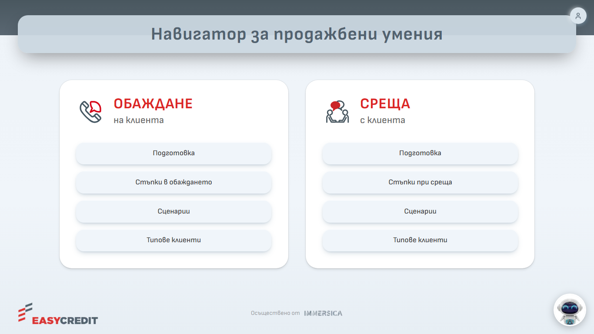
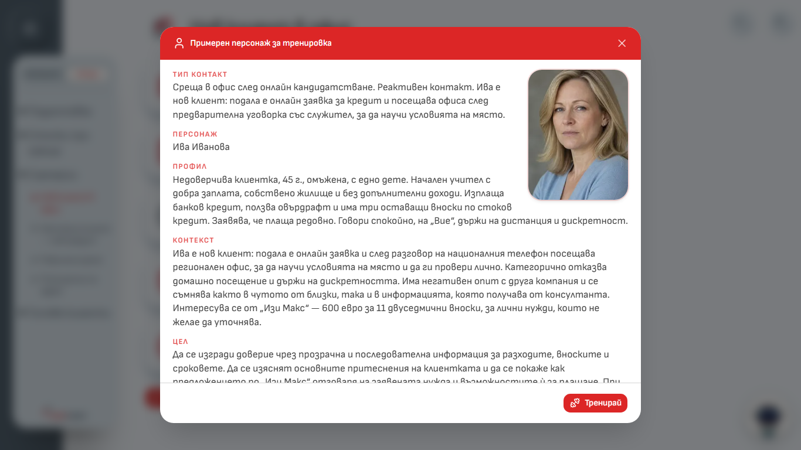
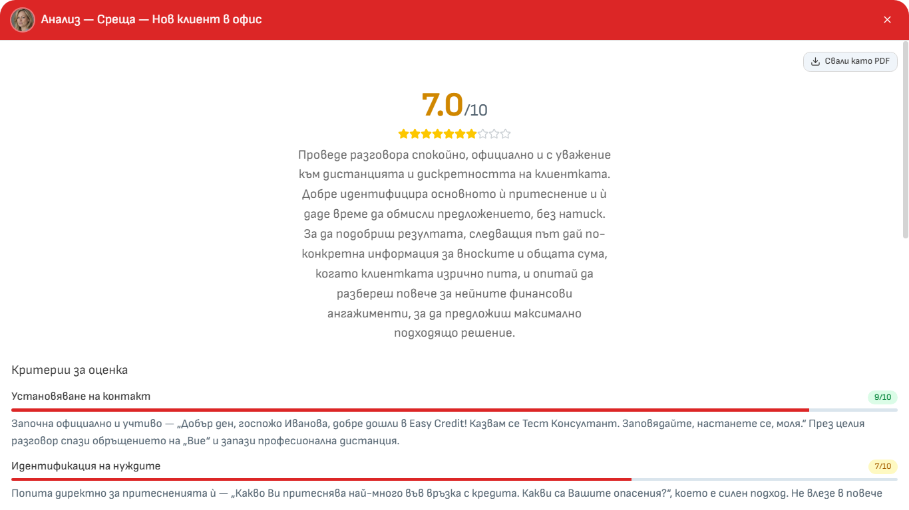
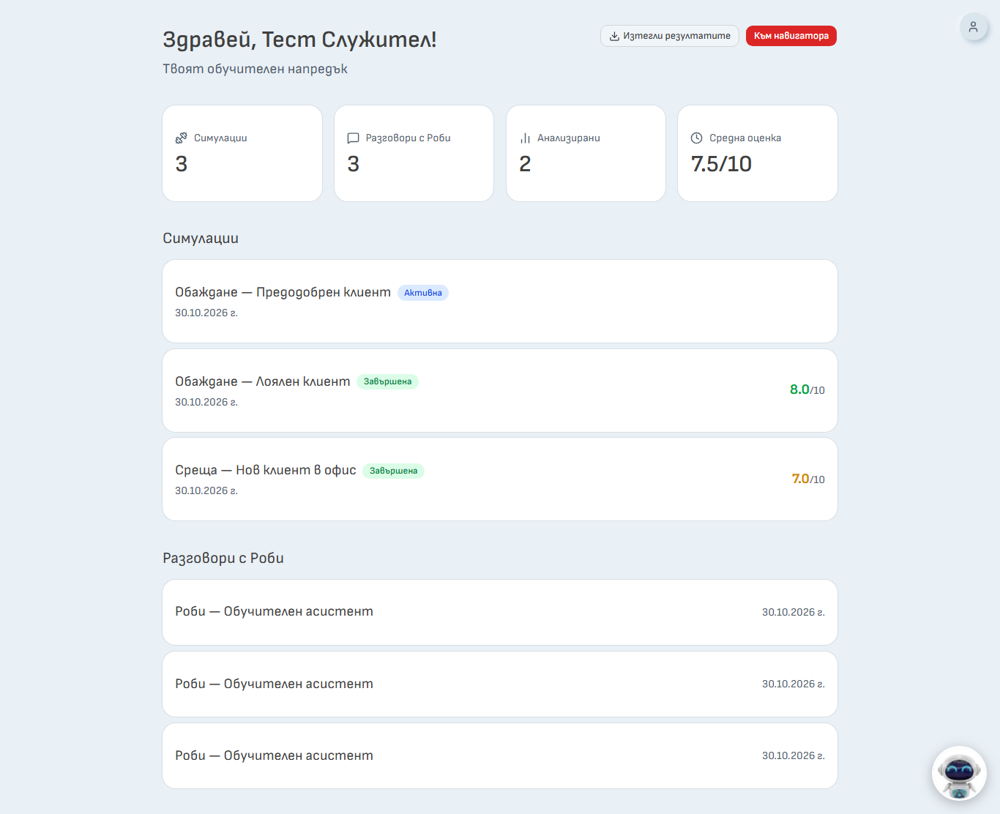

# Навигатор за продажбени умения – описание на системата

> **За кого е този документ:** за ръководството на Easy Credit, звеното „Обучение и развитие“ и Legal / DPO. Описва какво прави системата, кой какво вижда и какви данни се обработват.

---

## 1. Какво представлява системата

„Навигатор за продажбени умения“ е уеб приложение, което се отваря в браузър. Има две части:

1. **Обучителен навигатор** – наръчник по продажби в два канала: „Обаждане на клиента“ и „Среща с клиента“. Съдържа подготовка, стъпки на разговора, сценарии и типове клиенти.
2. **Симулатор** – консултантът води учебен разговор с **AI клиент**, който играе роля по готов сценарий. След разговора системата прави **анализ** с оценки и съвети.

Към тях има помощник – **Роби**, който отговаря на въпроси по обучението и по документите в „База знания“.

Всичко е на български. Сумите в сценариите са в евро.

*Снимка 3: Начален екран на навигатора с бутона на Роби долу вдясно*

---

## 2. Предназначение и изключени употреби

**Предназначение.** Системата е за **обучение и развитие** на консултантите: да упражняват разговори в безопасна среда и да получават обратна връзка.

**Системата не е предназначена за:**

- оценка на трудовото представяне на служителите, атестация или възнаграждение;
- дисциплинарни или други решения за служителя;
- работа с реални клиенти и реални заявки. Системата **не е свързана** с кредитните системи на Easy Credit. Сценариите са измислени, а „одобрение“ и „подписване“ в разговорите са само реплики;
- въвеждане на реални лични данни на клиенти или колеги.

**Важно за Legal / DPO:**

- Изречението „Само за обучение и развитие, не е оценка на работата“ се появява в приложението в листа „Информация“ на Excel файла с резултати.
- Технически администраторът **може** да види оценките и стенограмите на всеки потребител. Ограничението „не за оценка на работата“ е организационно, не техническо.

---

## 3. Потребители и роли

В системата има три роли. В екраните за администратори те се показват с английските им имена.

| Роля | Кой е | Какво може |
|---|---|---|
| `user` (служител) | Консултант, който се обучава | Навигатор, симулации, Роби, собствен профил, изтегляне на собствените резултати |
| `admin` (администратор) | Хора от звеното „Обучение и развитие“ | Всичко от `user` **плюс** админ панел: потребители, разговори, симулации, анализи, репорти, разходи, „База знания“, роли |
| `it` | Технически екип на Immersica | Всичко от `admin` **плюс** технически настройки: ботове, съдържание на обучението, конфигурация, одит лог |

Правила, които системата налага:

- Администраторът няма достъп до техническите страници. Роля `it` не може да се дава, променя или изтрива от `admin`.
- Никой не може да промени собствената си роля, да деактивира или да изтрие собствения си акаунт.
- Всяка смяна на роля се записва в „Одит лог“.
- Деактивиран потребител не може да влезе. Ако вече е влязъл, достъпът му се спира при следващото действие.

### Какво вижда администраторът

Администраторът вижда всичко, което потребителите са направили:

| Данни | Къде |
|---|---|
| Стенограми на симулации и разговори с Роби (на всеки потребител), заедно с това какво е търсил Роби в документите | „Разговори“, „Потребители“ → потребител |
| Анализи и оценки по критерии | същите места, „Анализи“, „Репорти“ |
| Всички стенограми за период в един Excel файл | „Репорти“ → „Транскрипти на чатове“ |
| Разходи по потребител | „Разходи“, „Репорти“, детайл на потребител |

- Няма отделна роля „администратор без достъп до индивидуалните резултати“.
- **Прегледите на администраторите не се записват.** „Одит лог“ пази само действия като изтриване, смяна на роля, деактивиране и промени в настройките.
- Експортът на резултати на потребител се записва. Експортът от „Репорти“ **не** се записва.

---

## 4. Основни модули

### 4.1. Навигатор и сценарии

Навигаторът има два канала, всеки с четири раздела: „Подготовка“, „Стъпки“, „Сценарии“ и „Типове клиенти“. Има **9 симулационни сценария** с измислени персонажи:

| Канал | Сценарий | Персонаж |
|---|---|---|
| Обаждане | Към лоялен клиент | Иван Иванов |
| Обаждане | Предварително одобрен | Надежда Петрова Иванова |
| Обаждане | По промо кампания | Стоян Георгиев |
| Обаждане | За продукт Пенсионер | Пламенка Георгиева Конова |
| Обаждане | По препоръка | Валя Пеева Стефанова |
| Среща | Нов клиент в офис | Ива Иванова |
| Среща | Настоящ клиент – нов кредит | Стоян Василев Илиев |
| Среща | Рефинансиране | Блажка Димитрова Шушкова |
| Среща | Посещение на адрес | София Иванова Петрова |

Към три от срещите има видео, което се зарежда от Google Drive.

### 4.2. AI клиент

- Консултантът пише (или говори) реплики, а AI клиентът отговаря **писмено** в ролята на персонажа.
- Преди разговора консултантът вижда **карта на персонажа**: тип контакт, профил, контекст, цел, примерни реплики, възможни възражения, подходящи техники и „Какво да не правиш“.
- С **микрофон** записът се превръща в текст и се вмъква в полето за писане. Консултантът го проверява и го изпраща.

*Снимка 7: Карта на персонажа – „Среща – Нов клиент в офис“*

### 4.3. Анализ и шестте критерия

След най-малко 6 реплики на консултанта той може да поиска анализ. Анализът се прави **автоматично от езиков модел** по настройка на сценария и по картата на персонажа. Съдържа обща оценка от 1 до 10, оценка и коментар по 6 критерия, „Силни страни“, „За подобрение“ и кратко обобщение.

| № | Критерий | Какво оценява (кратко) |
|---|---|---|
| 1 | Установяване на контакт | Представяне, учтивост, доверие и подходящо обръщение („Вие“ или „ти“ според клиента) |
| 2 | Идентификация на нуждите | Въпроси и активно слушане. При познат клиент не се очаква разпит от нулата |
| 3 | Представяне на продукт | Дали условията са свързани ясно и точно с нуждите на клиента |
| 4 | Справяне с възражения | Разбиране, отговор с полза, потвърждение и преминаване напред |
| 5 | Затваряне на сделката | Конкретна следваща стъпка, потвърдена с клиента |
| 6 | Резултат от симулацията | До къде разговорът е придвижил клиента към следваща стъпка в сравнение с очакваното за този клиент |

Правила на анализа: твърденията за консултанта се опират на реални реплики; обръщението „Вие / ти“ се оценява според персонажа; анализът е на „ти“ към консултанта; не твърди, че са станали кандидатстване, одобрение или подписване, ако това е само казано в симулацията. Анализ се прави **веднъж за разговор**.

*Снимка 12: Анализ на разговор – обща оценка и критерии*

### 4.4. Роби

- Достъпен е от бутона долу вдясно само за влезли потребители.
- Отговаря кратко и на български, само за обучението и документите в „База знания“. Ако не намери отговор, казва го и насочва към отдел „Бизнес обучение“.
- Не отговаря на въпроси за заплати, бонуси, отпуски, договори, HR и ИТ проблеми. При правни теми само пренасочва към прекия ръководител. Не изчислява вноски, лихви и ГПР.
- Към всеки въпрос получава и кратък преглед на **последните 5 разговора на потребителя**: заглавие, оценка и обобщение, последните няколко реплики (съкратени).
- Разговорите с Роби се записват, показват се в профила на потребителя и се виждат от администраторите.

### 4.5. База знания

- Администраторите качват документи (продукти, процедури, политики, фирмена информация), които Роби използва като справочник. Те **не променят поведението на Роби** и не могат да му дават инструкции.
- Формати: `.docx`, `.md`, `.txt`, най-много 4 MB. Пазят се последните 10 предишни версии.
- Преди всяко качване администраторът потвърждава, че документът не съдържа **забранени материали**. Потвърждението се проверява и от сървъра и се записва в „Одит лог“. Списъкът: лични данни на клиенти; пароли и достъпи; индивидуални цели и таргети; данни за представяне; критерии за атестация и оценка на служители; вътрешни файлове с чувствителни данни; сканирани снимки на таблици.
- „Изтрий“ премества документа в „Изтрити“ – Роби спира да го чете, но текстът остава. Само „Изтрий окончателно“ го премахва завинаги.

### 4.6. Профил на потребителя

- История на симулациите и разговорите с Роби (последните 50), оценки и статус („Завършена“, „Активна“, „Изоставена“). Всеки разговор се отваря със стенограма и анализ.
- Бутон „Изтегли резултатите“ – Excel файл с листове „Обобщение“, „Анализи“, „Стенограми“, „Информация“. Съдържа **само симулациите**, не и разговорите с Роби.

*Снимка 16: Профил на потребителя*

### 4.7. Администрация

Админ панелът има страници: Дашборд, Разговори (последните 200), Симулации, Потребители, Разходи (в USD), Анализи (с „AI Обобщение“ за период), Репорти (Excel доклад), База знания и Администратори (роли). Само за `it` са „Ботове“, „Обучение (tree.ts)“, „Конфигурация“ и „Одит лог“. Подробности – в „Инструкция за администратор“.

---

## 5. Какви данни се обработват и къде

### 5.1. Данни, които системата пази

| Данни | Какво съдържат | Кой ги вижда | Срок |
|---|---|---|---|
| **Акаунт** | Име, имейл, роля, статус, дата на регистрация, последна активност. Парола – само в хеширан вид | Потребителят; администраторите | Докато администратор не изтрие акаунта |
| **Разговори и стенограми** | Репликите на консултанта и на AI клиента / Роби, дата и час, заглавие на сценария, статус, технически данни за разход | Собственикът; `admin`, `it` | **12 месеца** от началото на разговора |
| **Анализи** | Оценки, коментари, силни страни, подобрения, обобщение | Собственикът; `admin`, `it` | Изтриват се заедно с разговора |
| **Търсения на Роби** | Какво е търсил Роби в документите и кои заглавия е намерил | `admin`, `it` | Изтриват се заедно с разговора |
| **Документи в „База знания“** | Извлеченият текст, заглавие, категория, предишни версии. **Оригиналният файл не се пази** | `admin`, `it`. Роби ползва откъси от тях при отговори на всички потребители | Докато администратор не ги изтрие окончателно |
| **Одит лог** | Кой, кога, какво действие, над какъв обект. За някои действия: имейл на потребител (при смяна на роля), ново име (при преименуване), заглавия на документи | `it` | Автоматично изтриване няма. При окончателно изтриване на акаунт имейлът и името в записите се заменят с „изтрит потребител“ |
| **Обобщени разходи** | По ден, потребител и модел: брой съобщения, токени, цена. **Без текст** | `admin`, `it` | Автоматично изтриване няма. При изтриване на акаунт връзката с потребителя се премахва |

Какво **не** се пази: **звукови записи** (звукът се изпраща за превръщане в текст, но не се съхранява), **прегледите на администраторите** и **оригиналните файлове** от „База знания“.

### 5.2. Къде се съхранява и кои доставчици участват

| Доставчик | За какво | Какви данни стигат до него |
|---|---|---|
| **Neon** (PostgreSQL) | Съхранение на всички данни | Всички данни. Базата е в ЕС (Франкфурт) |
| **Vercel** | Хостинг на приложението и ежедневните автоматични задачи | Заявките към приложението. Сървърите са в ЕС (Франкфурт) |
| **OpenAI** | Отговори на AI клиента и Роби, анализ, превръщане на реч в текст, търсене по смисъл, „AI Обобщение“ | Вижте 5.3 |
| **Google Drive** | Показване на видеата към сценариите | Зарежда се само когато потребител натисне „Видео“ |
| **Resend** (имейл) | Имейл за нулиране на парола, когато е включено | Имейл адрес и име на потребителя |

### 5.3. Какво се изпраща към OpenAI

| Функция | Какво се изпраща |
|---|---|
| Реплика в симулация | Настройките на сценария и цялата досегашна размяна на реплики в този разговор |
| Въпрос към Роби | Настройките на Роби, историята на разговора, подбрани откъси от обучението, кратък преглед на последните 5 разговора на потребителя |
| Анализ | Цялата стенограма на разговора и данните от картата на персонажа |
| Микрофон | Звукът (на парчета, докато се записва, и накрая цялото) |
| Качване на документ | Текстът на документа, за изчисляване на данни за търсене по смисъл |
| Търсене от Роби | Текстът на търсенето |
| „AI Обобщение“ | Силни страни, подобрения и обобщения от анализите за периода, **без имена и имейли** |

Приложението **не добавя** името и имейла на потребителя към тези заявки, но всичко, което консултантът напише или каже в разговора, се изпраща. Как OpenAI съхранява и ползва данните зависи от договора с OpenAI.

### 5.4. Модели

Всички ботове работят с езиков модел на OpenAI. Моделът се задава за всеки бот от ролята `it`. Сменянето му променя поведението на AI клиентите и на анализа, затова е отделно решение, което се съгласува с Easy Credit.

### 5.5. В браузъра на потребителя

Системата ползва бисквитка за вход (сесия, обикновено до 30 дни) и пази текущия разговор в браузъра, докато разделът е отворен. Не добавя бисквитки за проследяване или реклама. Видеото от Google Drive се зарежда от Google и може да постави свои бисквитки.

---

## 6. Срок на съхранение и изтриване

> Всяка нощ системата изтрива окончателно разговорите, проведени преди повече от 12 месеца (симулациите и разговорите с Роби), заедно със стенограмата и анализа им – както за потребителя, така и за администратора. Срокът тече за всеки разговор поотделно от датата на провеждането му (например през октомври 2027 се изтриват разговорите от октомври 2026). Изтритите данни не могат да бъдат възстановени. До изтичането на срока потребителят вижда резултатите си и може да ги изтегли като Excel файл. Акаунтът на потребителя не се изтрива автоматично – това става от администратор.

- Задачата работи всяка нощ (03:00 UTC, т.е. 05:00 или 06:00 българско време). При всяко пускане в „Одит лог“ се записва броят изтрити разговори, съобщения и анализи (без лични данни).
- **Не се изтриват автоматично:** акаунтите, „Одит лог“, обобщените разходи, документите в „База знания“.
- Администратор може да изтрие окончателно един потребител (с въвеждане на имейла) – тогава се изтриват акаунтът, всички негови разговори, стенограми и анализи. Журналът и документите се запазват без връзка към него. Администратор може да изтрие и отделен разговор.
- Потребителят **не може** сам да изтрие разговор – подава заявка към администратор.
- „Одит лог“ съдържа имейл адрес при смяна на роля и ново име при преименуване. При окончателно изтриване на акаунта те се заменят с „изтрит потребител“.

---

## 7. Вход и сигурност

**Вход днес:** с имейл и парола (най-малко 8 символа). Акаунтите се създават чрез регистрация, като всеки нов акаунт е с роля `user`.

**Предвидено:** вход през Easy Learn (single sign-on). След внедряването му регистрацията се затваря, а за администраторите остава резервен вход с имейл и парола.

Налични защити:

- Паролите се пазят хеширани.
- Всяка страница освен началния екран и страниците за вход, регистрация и нулиране на парола изисква вход. Страниците на админ панела изискват роля `admin` или `it`.
- Правата се проверяват на сървъра, не само в екрана. Потребител може да отваря само собствените си разговори.
- При всяка заявка се проверява дали акаунтът е активен.
- Изтриването, смяната на роля и деактивирането се записват в „Одит лог“.

---

## 8. Ограничения

- **AI може да греши.** Отговорите на AI клиента и на Роби и текстовете на анализа може да са неточни. Анализът е мнение на модел, не оценка от човек, и е учебна обратна връзка.
- **Симулацията не е реален клиент**, а „одобрение“, „договор“ и „отпускане“ в разговорите са само реплики. Системата не се свързва с кредитните системи на Easy Credit.
- **Роби вижда само част от обучението** (ограничен брой откъси към всеки въпрос), затова понякога казва, че не намира отговор. Не заменя вътрешните процедури, правните консултации и актуалните продуктови условия.
- Анализ е възможен само след най-малко 6 реплики на консултанта. Незавършена симулация, неактивна повече от 7 дни, се приключва автоматично: при поне 6 реплики се прави анализ и се отбелязва като незавършен, иначе разговорът е „Изоставена“.
- Админ списъците показват ограничен брой записи: „Разговори“ – последните 200, „Одит лог“ – последните 200, профилът на потребителя – последните 50.
- Разходите в „Разходи“ и „Репорти“ включват отговорите на AI клиентите и на Роби. **Не** включват анализите, микрофона и търсенето в документите.
