# Навигатор за продажбени умения – инструкция за служителя

> **За кого е този документ:** за консултантите на Easy Credit. Показва как се води учебен разговор, как се чете анализът и как се изтеглят резултатите. Системата е за **обучение и развитие**, не е оценка на работата ви.

---

## 1. Какво е това

Навигаторът е учебен наръчник по продажби с два канала – „Обаждане на клиента“ и „Среща с клиента“. В него можете да:

- прочетете как се подготвя и води разговор;
- **тренирате** с AI клиент по един от 9 сценария;
- получите **анализ** на разговора с оценки и съвети;
- попитате **Роби** – помощник, който отговаря на въпроси по обучението.

AI клиентът е измислен персонаж. Разговорът е учебен и не се отразява на реални клиенти и заявки.

---

## 2. Вход

Влезте в навигатора с профила си. Адресът ви е изпратен от администратора. След свързването с Easy Learn навигаторът ще се отваря директно от платформата, без отделен вход.

За изход натиснете иконата с човече горе вдясно, после **Изход**. От същото меню стигате до **Разговори** (вашия профил).

---

## 3. Начален екран и навигатор

Началният екран има две карти: **Обаждане на клиента** и **Среща с клиента**. Във всяка има четири раздела:

| Раздел | Какво има в него |
|---|---|
| Подготовка | Видове контакти и съвети за подготовка |
| Стъпки в обаждането / Стъпки при среща | Етапите на разговора, с примерни реплики и възражения |
| Сценарии | Учебните разговори с AI клиент |
| Типове клиенти | Как да се държите с различни типове клиенти |

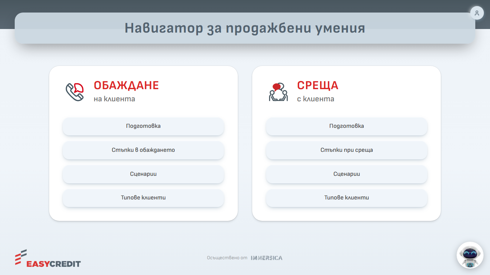

*Снимка 3: Начален екран с двете карти и бутона на Роби долу вдясно*

Вляво има меню, с което превключвате между **ОБАЖДАНЕ** и **СРЕЩА**. Бутонът с къщичка („Начало“) връща на началния екран. На телефон менюто се отваря с бутона „Отвори менюто“.

---

## 4. Сценарии и тренировка

Отворете **Сценарии** в избрания канал и изберете карта. Сценариите са 9: пет за обаждане (към лоялен клиент, предварително одобрен, по промо кампания, за продукт Пенсионер, по препоръка) и четири за среща (нов клиент в офис, настоящ клиент – нов кредит, рефинансиране, посещение на адрес).

Страницата на сценария показва примерен разговор по етапи. В края има бутони **Тренирай** и **Видео** (само при „Нов клиент в офис“, „Настоящ клиент – нов кредит“ и „Рефинансиране“).

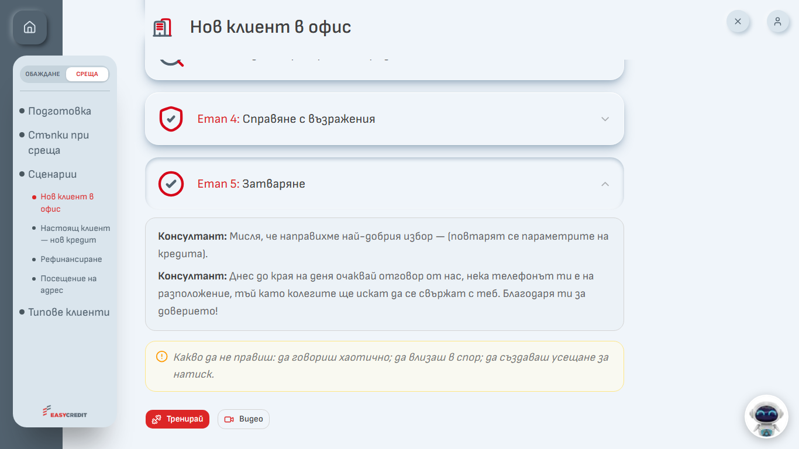

*Снимка 6: Страница на сценарий – бутони „Тренирай“ и „Видео“*

### 4.1. Карта на персонажа

С **Тренирай** първо се отваря прозорецът **Примерен персонаж за тренировка**: тип контакт, профил, контекст, цел, примерни реплики, възможни възражения, подходящи техники и „Какво да не правиш“. Прочетете го и натиснете **Тренирай** в долния десен ъгъл.

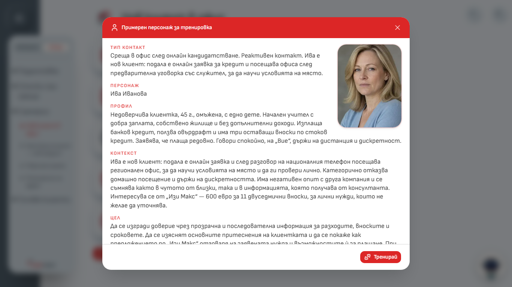

*Снимка 7: Карта на персонажа – „Среща – Нов клиент в офис“*

### 4.2. Незавършена симулация

Води се една симулация наведнъж. Ако имате започнат (поне една реплика) и недовършен друг сценарий, при **Тренирай** се показва „Имаш незавършена симулация“:

- **Продължи я** – връща ви към започнатия сценарий;
- **Откажи я и започни нова** – започнатият разговор се отбелязва като „Изоставена“;
- **Отказ** – затваря съобщението.

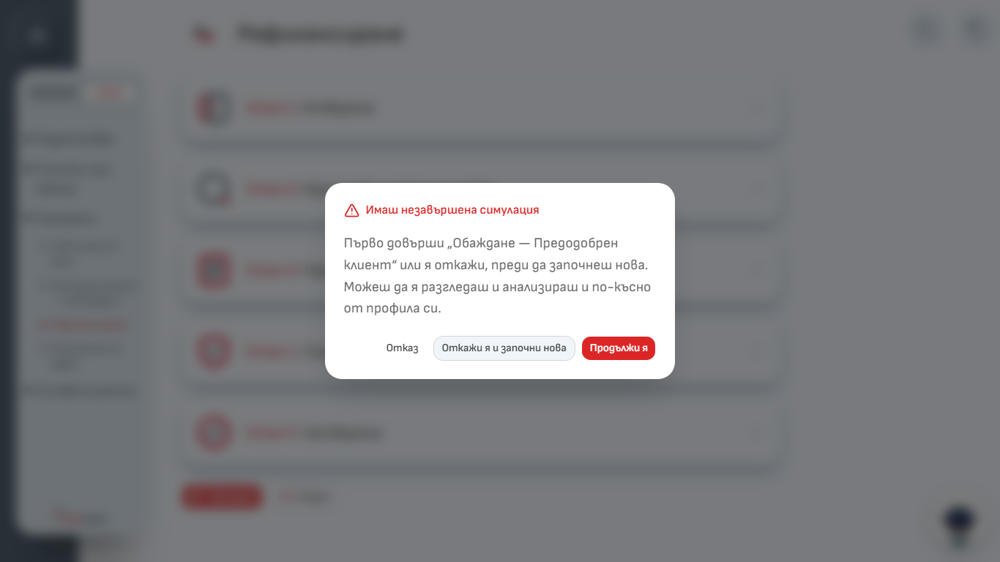

*Снимка 14: Съобщение „Имаш незавършена симулация“*

„Продължи я“ връща репликите само ако не сте затваряли раздела на браузъра. Иначе изберете „Откажи я и започни нова“.

---

## 5. Разговор с AI клиента

След **Тренирай** се отваря прозорец на цял екран с първата реплика на AI клиента.

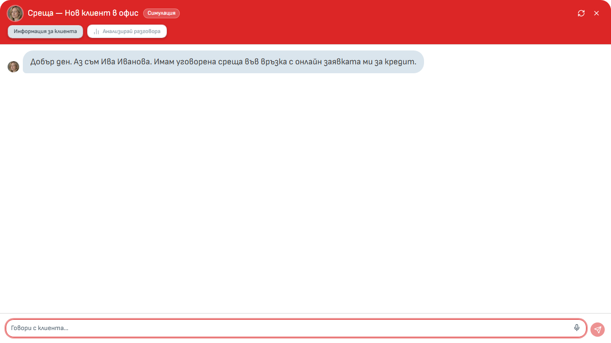

*Снимка 8: Начало на симулация – първата реплика на AI клиента*

Бутони горе: **Информация за клиента** (показва картата на персонажа; „Обратно към разговора“ ви връща), **Анализирай разговора** (вж. раздел 6), стрелките в кръг („Започни симулацията наново“) и **×** (затваря прозореца; разговорът се пази, докато разделът на браузъра е отворен).

**Писане.** Напишете репликата в полето „Говори с клиента…“ и натиснете **Enter** (**Shift + Enter** – нов ред). Говорете като с истински клиент и спазвайте обръщението („Вие“ или „ти“), което подхожда на персонажа.

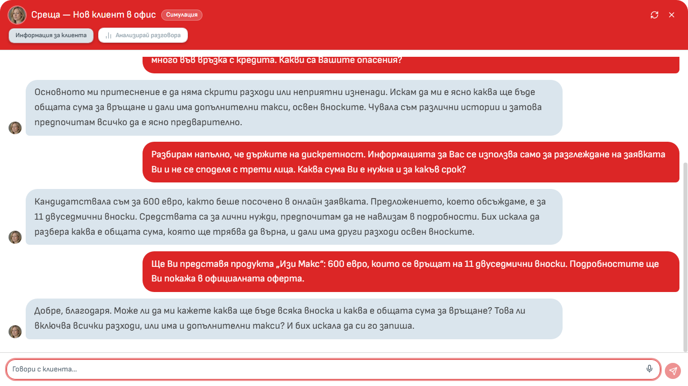

*Снимка 9: Разговор с няколко реплики и бутон за микрофон в полето за писане*

**Микрофон.** Микрофонът пише вместо вас – AI клиентът отговаря с текст.

1. Натиснете иконата на микрофона в полето за писане и разрешете достъпа, ако браузърът го поиска.
2. Говорете на български. След около 2,5 секунди пауза записът спира сам (или го спрете със същата икона).
3. Текстът се вписва в полето. **Проверете го**, поправете го и го изпратете.

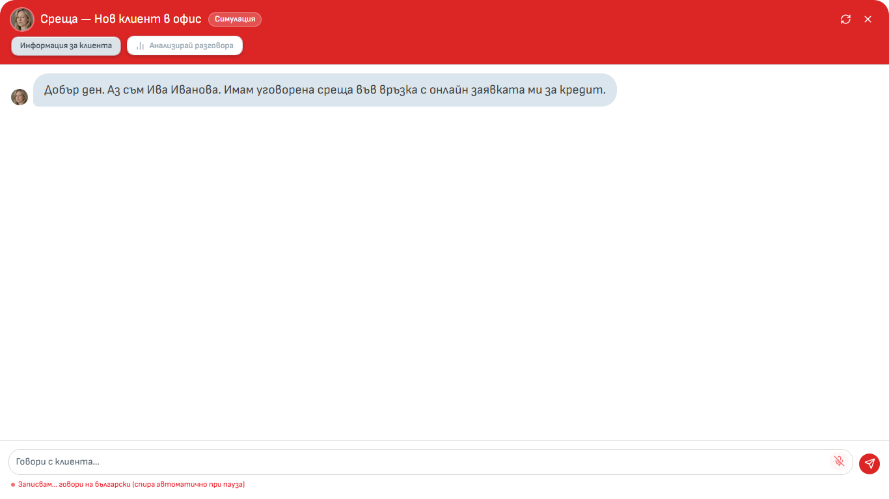

*Снимка 10: Запис с микрофон – „Записвам…“*

Ако се покаже „Достъпът до микрофона е блокиран“, разрешете го от иконата с катинар в адресната лента. Звукът се превръща в текст от услугата на OpenAI; системата **не пази** звукови записи, а само текста на изпратената реплика.

**Съвети:** не въвеждайте реални лични данни на клиенти или колеги; сумите в сценариите са в евро; ако AI клиентът излезе от ролята си, започнете наново и съобщете на администратора, ако се повтаря.

---

## 6. Приключване и анализ

Анализът става достъпен след **най-малко 6 ваши реплики** (преди това бутонът **Анализирай разговора** е сив и показва колко реплики остават). Натиснете го и изчакайте няколко секунди. Анализ се прави **само веднъж** за разговор.

Ако не го натиснете, разговорът остава в профила като „Активна“ и можете да натиснете **Генерирай анализ**. След повече от 7 дни без активност системата го приключва сама: при поне 6 реплики прави анализ, иначе отбелязва разговора като „Изоставена“.

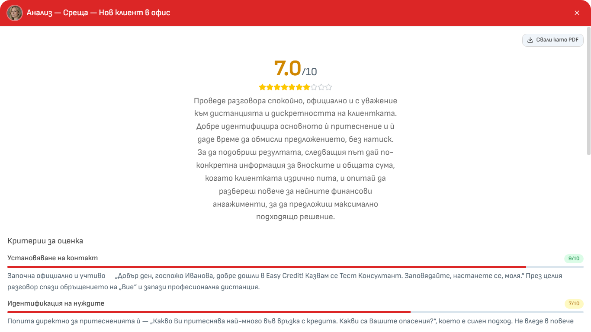

*Снимка 12: Анализ – обща оценка и критерии*

Анализът съдържа **обща оценка** от 1 до 10 (зелено – 8 и повече, жълто – от 6 до под 8, червено – под 6), обобщение, **шест критерия** с оценка и коментар, **Силни страни** и **За подобрение**. Под оценката пише „Само за обучение и развитие, не е оценка на работата.“

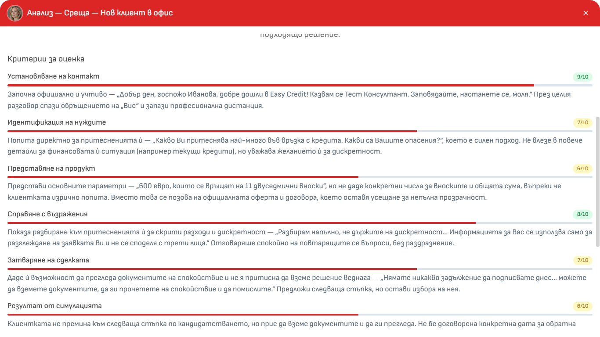

*Снимка 32: Анализ – шестте критерия, включително „Резултат от симулацията“*

| Критерий | Какво се оценява |
|---|---|
| Установяване на контакт | Представяне, учтивост, доверие, подходящо обръщение |
| Идентификация на нуждите | Въпроси и слушане, за да разберете клиента |
| Представяне на продукт | Свързване на условията с нуждите на клиента |
| Справяне с възражения | Как сте реагирали на притесненията на клиента |
| Затваряне на сделката | Ясна следваща стъпка в края |
| Резултат от симулацията | До къде сте придвижили клиента към следваща стъпка |

Бутони: **Свали като PDF** (отваря печат на браузъра – изберете запис като PDF), **Разговорът** и **Затвори**.

Анализът е направен от AI и може да греши. Четете го като съвет, не като присъда. Не е оценка на работата ви.

---

## 7. Роби – помощник

Роби е кръглата снимка долу вдясно на всяка страница. Натиснете я, напишете въпроса си в „Попитай Роби…“ и натиснете Enter. Стрелките в кръг започват нов разговор.

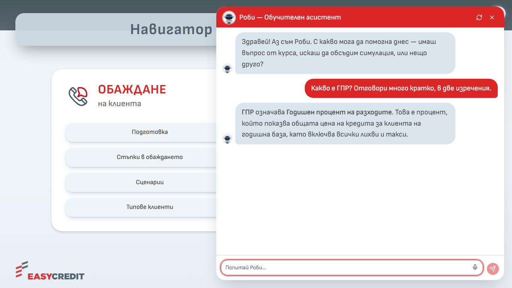

*Снимка 15: Роби – отворен прозорец с отговор*

Питайте го къде какво се намира в обучението, как се прави даден етап, как да се справите с възражение, за разбор на ваша симулация, за продуктови условия и процедури от „База знания“.

Роби **не** отговаря на въпроси за заплати, бонуси, отпуски, договори, HR и ИТ проблеми (насочва към отдел „Бизнес обучение“); при правни теми само пренасочва към прекия ръководител; не изчислява вноски, лихви и ГПР (ползвайте официалния калкулатор); ако не намери отговор, го казва. Роби също може да греши – за важни въпроси проверявайте с ръководителя си.

Роби вижда подбрани откъси от обучението и документите и кратък преглед на последните ви разговори. Разговорите с Роби се записват и се показват в профила ви.

---

## 8. Профил и резултати

Иконата с човече горе вдясно → **Разговори**.

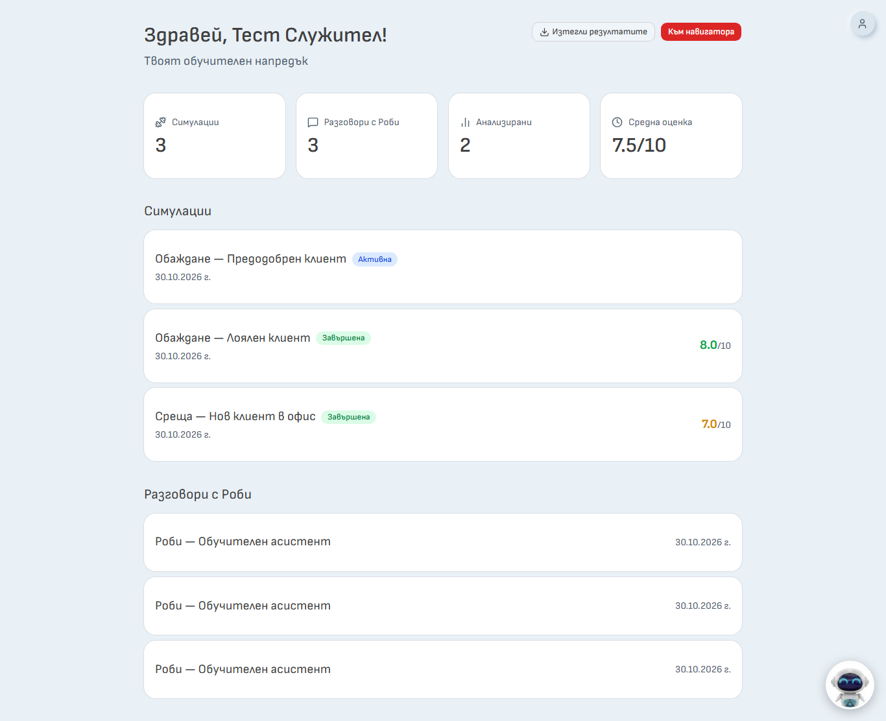

*Снимка 16: Профил – „Здравей, …!“, показатели и списък на симулациите*

Виждате показателите (**Симулации**, **Разговори с Роби**, **Анализирани**, **Средна оценка**), списък на симулациите със статус („Завършена“, „Активна“, „Изоставена“), дата и оценка, и списък на разговорите с Роби (последните 50). С клик върху разговор отваряте **Транскрипта** и **Анализа**.

**Изтегли резултатите** изтегля Excel файл `Navigator_rezultati_<име>_<дата>.xlsx` с четири листа: „Обобщение“ (по един ред на симулация с оценките), „Анализи“, „Стенограми“ (всяка реплика) и „Информация“ (кой е изтеглил и кога, период, скала на оценките, срок на съхранение). Файлът съдържа само симулациите, не и разговорите с Роби. Пазете го на сигурно място – съдържа вашите стенограми.

---

## 9. Срок на съхранение

Всеки ден системата изтрива окончателно разговорите, проведени преди повече от 12 месеца, заедно със стенограмата и анализа им – за вас и за администратора. Срокът тече за всеки разговор поотделно. Изтритите данни не могат да бъдат възстановени. Ако искате да пазите резултатите по-дълго, изтеглете ги. Акаунтът ви не се изтрива автоматично.

Администраторите на обучението могат да виждат разговорите и анализите на всички потребители. Сами не можете да изтриете разговор – при нужда се обърнете към администратор.

---

## 10. Често задавани въпроси

**Оценява ли ме анализът като служител?**
Не. Анализът е учебна обратна връзка.

**Защо не мога да натисна „Анализирай разговора“?**
Трябват поне 6 ваши реплики. Системата показва колко остават.

**Затворих браузъра по средата. Какво става?**
Разговорът остава в профила като „Активна“. Отворете го и натиснете **Генерирай анализ**, ако има поне 6 реплики. Продължаване на разговора в чата не е възможно.

**Микрофонът не работи.**
Разрешете достъпа до микрофона в браузъра (иконата с катинар до адреса) и проверете дали е избрано правилното устройство. Можете да пишете с клавиатура.

**Кой вижда разговорите ми?**
Вие и администраторите на системата.

**Към кого да се обърна за помощ?**
При проблем или въпрос се обърнете към вашия администратор в Easy Credit – екипа „Обучение и развитие“.
