# Навигатор за продажбени умения – инструкция за служителя

> **За кого е този документ:** за консултантите на Easy Credit, които се обучават със симулатора. Показва стъпка по стъпка как се влиза, как се води учебен разговор, как се чете анализът и как се изтеглят резултатите.
> Системата е за **обучение и развитие**. Не е оценка на работата ви.
> Състояние: чернова от 30.10.2026.

---

## 1. Какво е това

Навигаторът е учебен наръчник по продажби с два канала – „Обаждане на клиента“ и „Среща с клиента“. В него можете да:

- прочетете как се подготвя и води разговор;
- **тренирате** с AI клиент по един от 9 сценария;
- получите **анализ** на разговора с оценки и съвети;
- попитате **Роби** – помощник, който отговаря на въпроси по обучението.

AI клиентът е измислен персонаж. Разговорът е учебен – не се отразява на реални клиенти и заявки.

---

## 2. Вход

### 2.1. Как да влезете

1. Отворете адреса на навигатора в браузъра. **[ДА СЕ ПРОВЕРИ: адрес на продукцията]**
2. Натиснете иконата с човече горе вдясно (подсказка „Вход“).
3. Въведете **Имейл** и **Парола**.
4. Натиснете **Вход**.

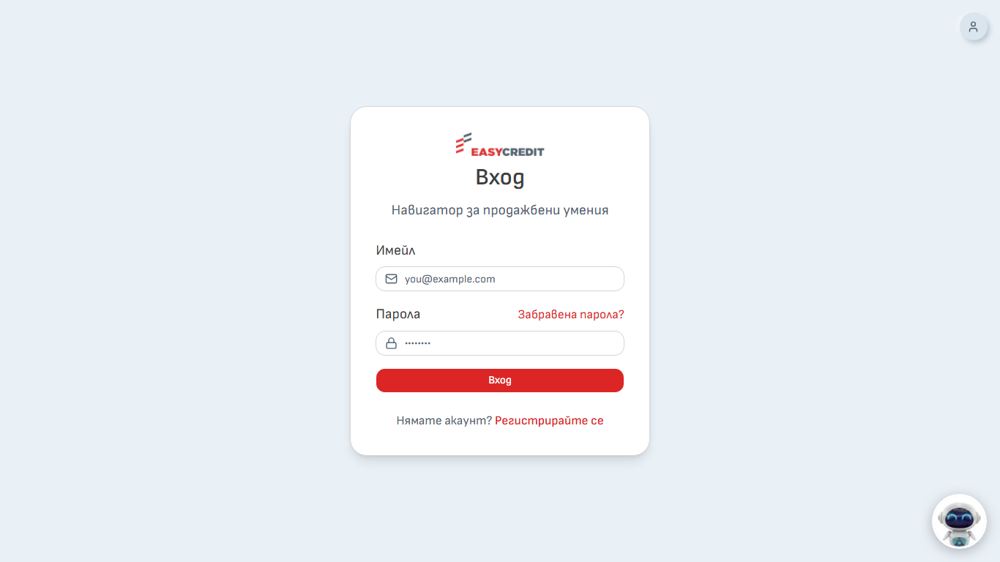

*Снимка 1: Страница „Вход“*
Ако има бутони **Продължи с Google** или **Продължи с Microsoft**, можете да влезете и с тях. Показват се само когато са включени. **[ДА СЕ ПРОВЕРИ: включени ли са на продукцията]**

Ако не влиза, системата показва причината:

| Съобщение | Какво да направите |
|---|---|
| „Няма регистриран потребител с този имейл.“ | Проверете имейла или се регистрирайте |
| „Грешна парола.“ | Опитайте пак или използвайте „Забравена парола?“ |
| „Този акаунт е деактивиран. Свържете се с администратор.“ | Обърнете се към администратора |
| „Този акаунт е създаден чрез Google или Microsoft. Влезте със съответния бутон по-долу.“ | Влезте с бутона на съответния доставчик |

### 2.2. Първо влизане (регистрация)

Днес акаунт се създава така:

1. На страницата „Вход“ натиснете **Регистрирайте се**.
2. Попълнете **Имена**, **Имейл**, **Парола** (най-малко 8 символа) и **Потвърди паролата**.
3. Натиснете **Регистрирай се**. След това влизате автоматично.

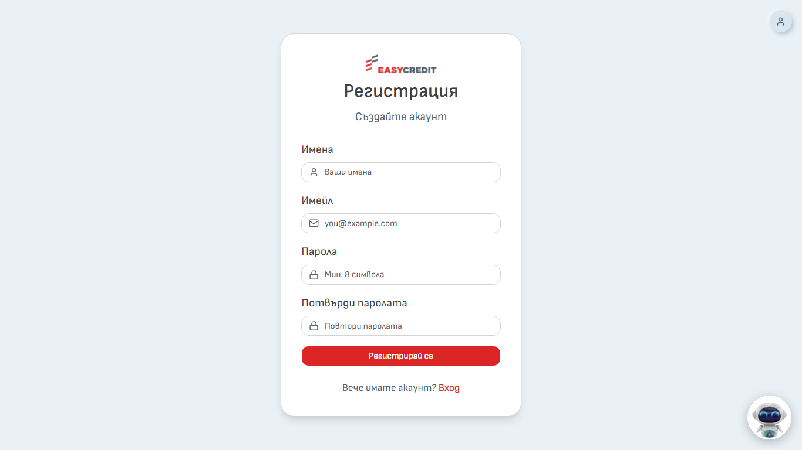

*Снимка 2: Страница „Регистрация“*
Регистрацията е отворена до въвеждането на входа през Easy Learn. След него служителите влизат директно от Easy Learn и този раздел отпада.

### 2.3. Забравена парола

1. На страницата „Вход“ натиснете **Забравена парола?**.
2. Въведете имейла си и натиснете **Изпрати линк**.
3. Отворете писмото и натиснете линка в него. Линкът важи 1 час.
4. Въведете **Нова парола** два пъти и натиснете **Запази паролата**.

**[ДА СЕ ПРОВЕРИ: дали писмата за нулиране се изпращат на продукцията.]** Ако писмо не пристигне, обърнете се към администратор.

### 2.4. Изход

Натиснете иконата с човече горе вдясно, после **Изход**.

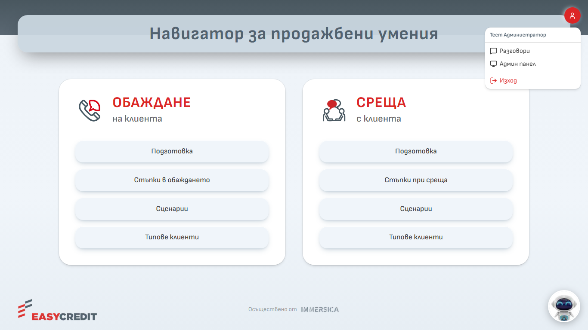

*Снимка 4: Меню на профила – „Разговори“, „Админ панел“ (само за администратори), „Изход“*
> **Предвидено:** вход през Easy Learn. Все още не е пуснат. Когато бъде пуснат, тази инструкция ще се обнови.

---

## 3. Начален екран и навигатор

Началният екран има две карти: **Обаждане на клиента** и **Среща с клиента**. Във всяка има бутони към четирите раздела:

| Раздел | Какво има в него |
|---|---|
| Подготовка | Видове контакти и съвети за подготовка |
| Стъпки в обаждането / Стъпки при среща | Етапите на разговора, с примери |
| Сценарии | Учебните разговори с AI клиент |
| Типове клиенти | Как да се държите с различни типове клиенти |

*Снимка 3: Начален екран с двете карти и бутона на Роби долу вдясно*
Всеки раздел има своя страница:

- **Подготовка** – разгъваеми карти „Видове контакти“ (студен, топъл, регулярен контакт) и карта „Съвети за подготовка“.
- **Стъпки в обаждането / Стъпки при среща** – горе има лента с етапите. Страницата на етапа показва „Цел“, „Обща логика“ и примерни реплики и възражения, които се разгъват с клик.
- **Типове клиенти** – за всеки тип има „Характеристики“ и „Препоръчителна комуникация“.

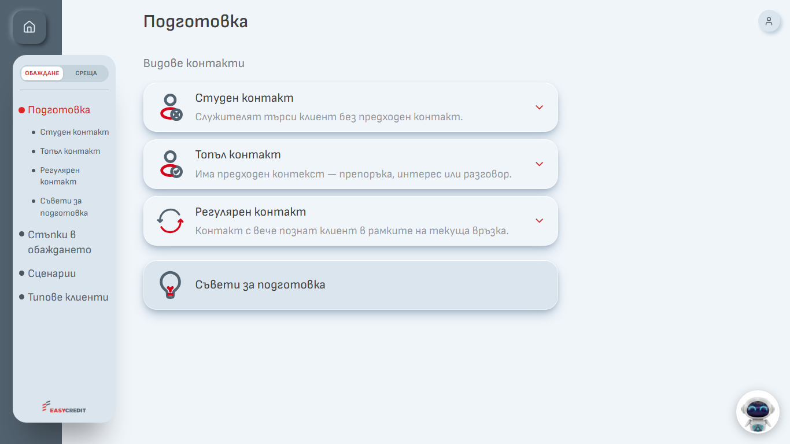

*Снимка 33: Раздел „Подготовка“ – видове контакти и съвети*

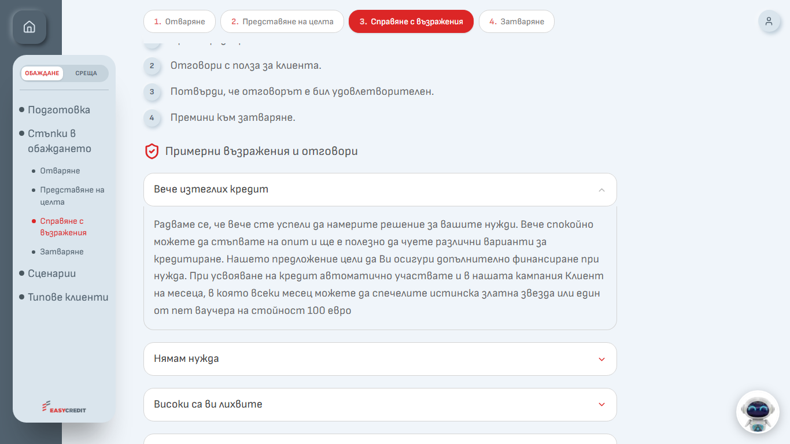

*Снимка 34: Страница на етап („Справяне с възражения“) с разгънато примерно възражение*

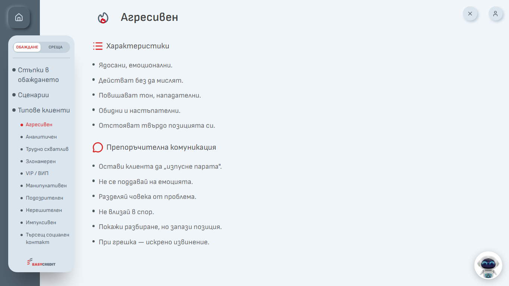

*Снимка 35: Тип клиент „Агресивен“ – характеристики и препоръчителна комуникация*

Вляво има меню. Горе в него можете да превключвате между **ОБАЖДАНЕ** и **СРЕЩА**. Бутонът с къщичка („Начало“) ви връща на началния екран. На телефон менюто се отваря с бутона „Отвори менюто“.

---

## 4. Избор на сценарий

1. Отворете **Сценарии** в избрания канал.
2. Изберете карта със сценарий.

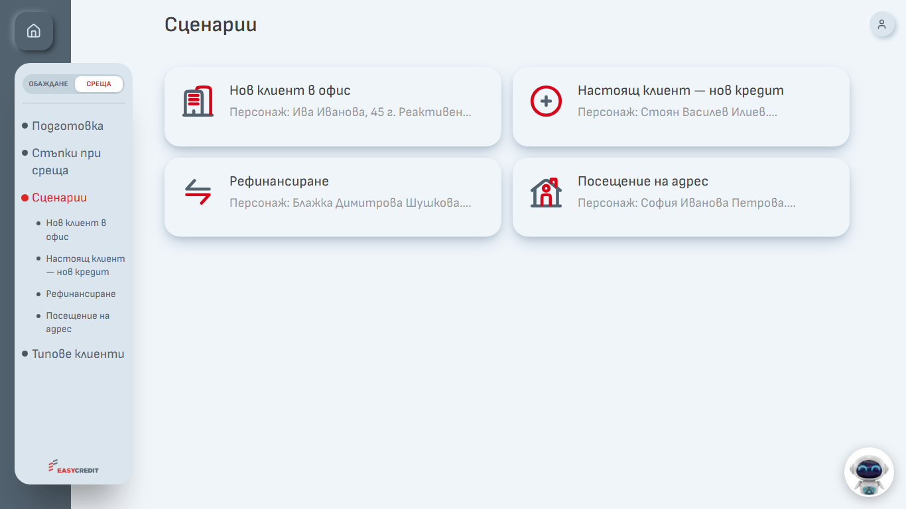

*Снимка 5: Списък „Сценарии“ в канал „Среща“*
Сценариите са 9:

| Канал | Сценарий |
|---|---|
| Обаждане | Към лоялен клиент |
| Обаждане | Предварително одобрен |
| Обаждане | По промо кампания |
| Обаждане | За продукт Пенсионер |
| Обаждане | По препоръка |
| Среща | Нов клиент в офис |
| Среща | Настоящ клиент – нов кредит |
| Среща | Рефинансиране |
| Среща | Посещение на адрес |

Страницата на сценария показва примерен разговор по етапи. Етапите се разгъват с клик.

В края на страницата има бутони:

- **Тренирай** – започва учебния разговор;
- **Видео** – има само при „Нов клиент в офис“, „Настоящ клиент – нов кредит“ и „Рефинансиране“.

*Снимка 6: Страница на сценарий – бутони „Тренирай“ и „Видео“*
### 4.1. Карта на персонажа

Когато натиснете **Тренирай**, първо се отваря прозорецът **Примерен персонаж за тренировка**. Прочетете го внимателно. В него има:

- Тип контакт
- Персонаж
- Профил
- Контекст
- Цел
- Логика на разговора
- Примерни реплики
- Възможни възражения
- Подходящи техники
- Следваща стъпка / финализиране
- Какво да не правиш

Когато сте готови, натиснете **Тренирай** в долния десен ъгъл на прозореца. Прозорецът се затваря с **×**.

*Снимка 7: Карта на персонажа – „Среща – Нов клиент в офис“*

Долната част на картата съдържа „Възможни възражения“, „Подходящи техники“, „Следваща стъпка / финализиране“ и „Какво да не правиш“. Превъртете прозореца надолу, за да ги прочетете.

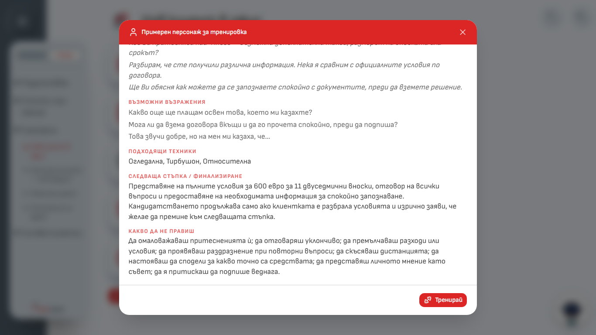

*Снимка 36: Карта на персонажа – долната част (възражения, техники, следваща стъпка, какво да не правиш)*
### 4.2. Ако имате незавършена симулация

Може да се води една симулация наведнъж. Ако сте започнали друг сценарий (изпратили сте поне една реплика) и не сте го довършили, при натискане на **Тренирай** се показва „Имаш незавършена симулация“. Можете да изберете:

- **Продължи я** – връща ви към започнатия сценарий;
- **Откажи я и започни нова** – започнатият разговор се отбелязва като „Изоставена“, а вие започвате новия;
- **Отказ** – затваря съобщението.

*Снимка 14: Съобщение „Имаш незавършена симулация“*
Забележка: „Продължи я“ връща разговора с репликите само ако не сте затваряли раздела на браузъра. Ако сте го затворили, ще видите нов празен разговор, а старият остава „Активна“ в профила. Тогава изберете „Откажи я и започни нова“.

---

## 5. Разговор с AI клиента

След **Тренирай** се отваря прозорец на цял екран с името на сценария (например „Среща — Нов клиент в офис“) и надпис „Симулация“. Показва се първата реплика на AI клиента.

*Снимка 8: Начало на симулация – първата реплика на AI клиента*
### 5.1. Бутони горе

| Бутон | Какво прави |
|---|---|
| **Информация за клиента** | Показва отново картата на персонажа. Бутонът „Обратно към разговора“ ви връща |
| **Анализирай разговора** | Приключва разговора и прави анализ (вж. раздел 6) |
| Стрелките в кръг (подсказка „Започни симулацията наново“) | Започва разговора от начало |
| **×** | Затваря прозореца |

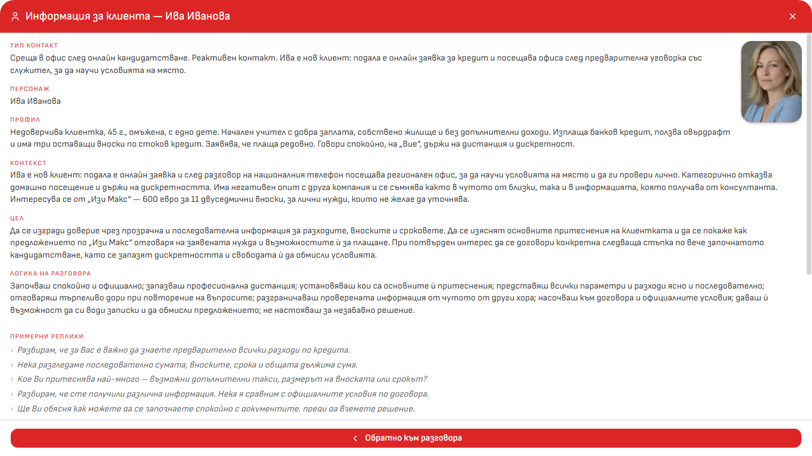

*Снимка 11: „Информация за клиента“ върху разговора*
### 5.2. Разговор с писане

1. Напишете репликата си в полето „Говори с клиента…“.
2. Натиснете **Enter** или бутона за изпращане. С **Shift + Enter** минавате на нов ред.
3. Изчакайте отговора на AI клиента и продължете.

Говорете като с истински клиент. Спазвайте обръщението („Вие“ или „ти“), което подхожда на персонажа.

*Снимка 9: Разговор с няколко реплики и бутон за микрофон в полето за писане*
### 5.3. Разговор с микрофон

Микрофонът пише вместо вас. Не е разговор с глас – AI клиентът отговаря с текст.

1. Натиснете иконата на микрофона вдясно в полето за писане (подсказка „Гласово писане на български“).
2. Ако браузърът поиска разрешение за микрофона, разрешете го.
3. Говорете на български. Показва се „Записвам… говори на български (спира автоматично при пауза)“. Докато говорите, текстът се появява в полето.
4. Спрете да говорите. След около 2,5 секунди пауза записът спира сам. Можете да го спрете и ръчно със същата икона (подсказка „Спри гласовото писане“).
5. Показва се „Обработвам гласа…“. Текстът се вписва в полето.
6. **Проверете текста** и го поправете, ако е нужно. После го изпратете.

Ако натиснете изпращане, докато още записвате, записът спира и репликата се изпраща след обработката.

Ако се покаже „Достъпът до микрофона е блокиран“, натиснете иконата с катинар в адресната лента на браузъра и разрешете микрофона. Ако браузърът не поддържа запис, иконата на микрофона не се показва.

*Снимка 10: Запис с микрофон – „Записвам…“*
**Какво се случва със записа:** звукът се изпраща към услугата за превръщане на реч в текст на OpenAI. Системата **не пази** звукови записи. Пази се само текстът на репликата, която изпратите.

### 5.4. Съвети

- Не въвеждайте реални лични данни на клиенти или колеги. Сценариите са измислени.
- Сумите в сценариите са в евро.
- Ако AI клиентът каже нещо необичайно, може да започнете наново. Съобщете на администратор, ако се повтаря.
- Ако затворите прозореца със **×**, разговорът се пази, докато разделът на браузъра е отворен. Върнете се с **Тренирай** и продължете.

---

## 6. Приключване и анализ

1. Анализът става достъпен след **най-малко 6 ваши реплики**. Преди това бутонът **Анализирай разговора** е сив. Ако го натиснете, се показва колко реплики остават.
2. Когато сте готови, натиснете **Анализирай разговора**. Изчакайте – анализът отнема няколко секунди.
3. Отваря се екран „Анализ – …“.
4. След анализа разговорът е приключен. Когато се върнете към разговора с бутона **Разговорът**, виждате бутоните **Нова симулация** и **Виж анализа**.

Анализ се прави **само веднъж** за разговор.

Ако не натиснете бутона:

- Разговорът остава в профила със статус „Активна“. Можете да го отворите и да натиснете **Генерирай анализ** (нужни са поне 6 реплики).
- Ако разговорът е неактивен повече от 7 дни, системата го приключва сама. При поне 6 реплики прави анализ и го отбелязва като незавършен, иначе го отбелязва като „Изоставена“.

---

## 7. Как се чете анализът

*Снимка 12: Анализ – обща оценка и критерии*

*Снимка 32: Анализ – шестте критерия, включително „Резултат от симулацията“*
Анализът съдържа:

- **Обща оценка** от 1 до 10 и кратко обобщение. Цветове: зелено – 8 и повече, жълто – от 6 до под 8, червено – под 6.
- **Критерии за оценка** – шест критерия с оценка и коментар.
- **Силни страни** – какво е станало добре.
- **За подобрение** – какво може да се направи по-различно.

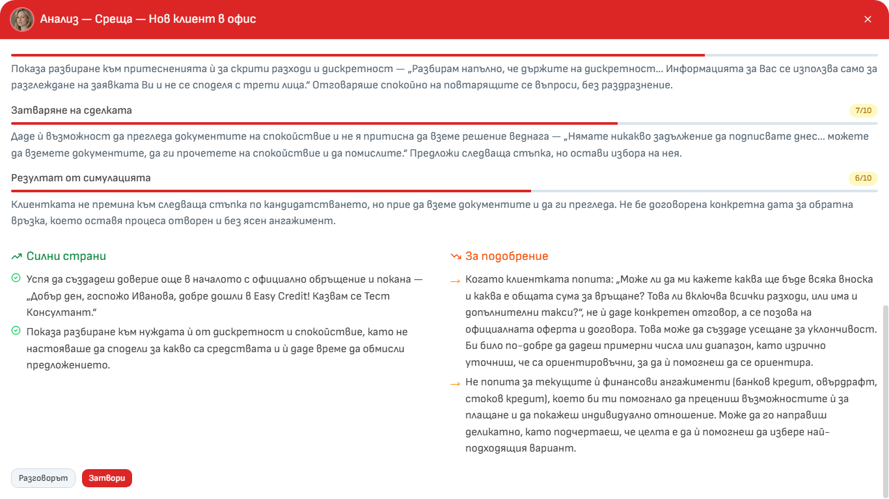

*Снимка 13: Анализ – „Силни страни“, „За подобрение“ и бутони долу*
Шестте критерия:

| Критерий | Какво се оценява |
|---|---|
| Установяване на контакт | Как сте започнали: представяне, учтивост, доверие, подходящо обръщение |
| Идентификация на нуждите | Задавали ли сте въпроси и слушали ли сте, за да разберете клиента |
| Представяне на продукт | Дали сте свързали условията с нуждите на клиента |
| Справяне с възражения | Как сте реагирали на притесненията на клиента |
| Затваряне на сделката | Как сте завършили: има ли ясна следваща стъпка |
| Резултат от симулацията | До къде сте придвижили клиента към следваща стъпка |

Бутони в анализа:

- **Свали като PDF** – отваря прозореца за печат на браузъра. Изберете запис като PDF (названието зависи от браузъра).
- **Разговорът** – връща ви към разговора.
- **Затвори** – затваря прозореца.

Важно:

- Анализът е направен от AI. Може да греши. Четете го като съвет, не като присъда.
- Анализът не е оценка на работата ви. Той е учебна обратна връзка.
- Анализът е написан на „ти“ и се опира на вашите реплики.

---

## 8. Роби – помощник

Роби е кръглата снимка долу вдясно на всяка страница.

1. Натиснете снимката (подсказка „Роби – асистент“). Ако не сте влезли, ще ви отведе към „Вход“.
2. Напишете въпроса си в полето „Попитай Роби…“ и натиснете Enter. Можете да ползвате и микрофона.
3. Затворете прозореца с **×**. Стрелките в кръг започват нов разговор.

*Снимка 15: Роби – отворен прозорец с отговор*
**За какво да го питате:** какво къде се намира в обучението, как се прави даден етап, как да се справите с възражение, разбор на ваша симулация, продуктови условия и процедури от „База знания“.

**Какво Роби не прави:**

- Не отговаря на въпроси за заплати, бонуси, отпуски, договори, HR и ИТ проблеми. Насочва към отдел „Бизнес обучение“ или към прекия ви ръководител.
- При правни теми (съд, жалба, събиране на вземания, регулатор) само ви пренасочва към прекия ръководител.
- Не изчислява вноски, лихви и ГПР. Използвайте официалния калкулатор на компанията.
- Не препоръчва конкретен канал за комуникация с клиента.
- Ако не намери отговор, казва го. Не измисля.

**Какво вижда Роби:** подбрани откъси от обучението и документите, както и кратък преглед на последните ви разговори (заглавие, оценка, обобщение, последни реплики).

Роби също може да греши. За важни въпроси проверявайте с вашия ръководител или с отдел „Бизнес обучение“.

Разговорите с Роби се записват и се показват в профила ви.

---

## 9. Профил и изтегляне на резултатите

Отворете иконата с човече горе вдясно и изберете **Разговори**.

*Снимка 16: Профил – „Здравей, …!“, показатели и списък на симулациите*
Страницата показва:

- **Симулации**, **Разговори с Роби**, **Анализирани**, **Средна оценка**;
- списък със симулациите – име на сценария, статус („Завършена“, „Активна“, „Изоставена“), дата и оценка;
- списък с разговорите с Роби.

Показват се последните 50 разговора.

Натиснете разговор, за да видите **Транскрипт** (стенограмата) и **Анализ**.

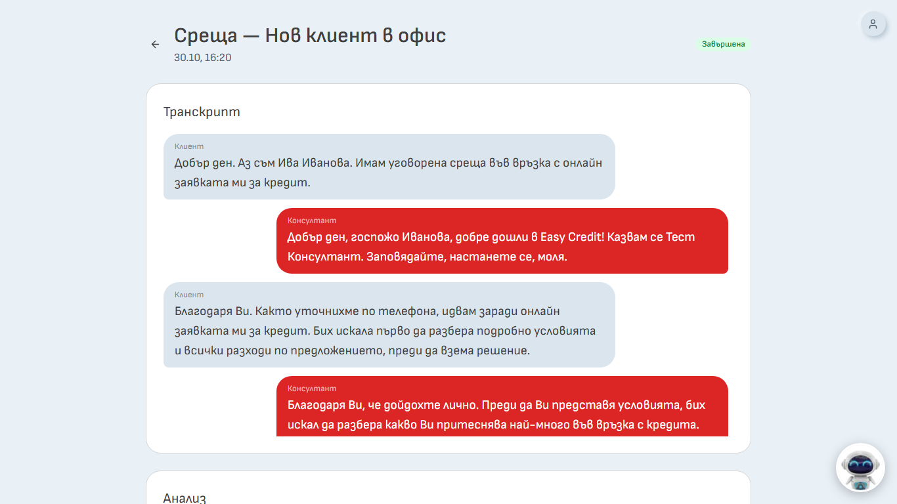

*Снимка 17: Разговор в профила – транскрипт и анализ*
> В разговор с Роби отговорите му са означени с „Клиент“. Това е само означение в стенограмата.

### 9.1. Изтегляне на резултатите

1. В профила натиснете **Изтегли резултатите**.
2. Файлът се изтегля като `Navigator_rezultati_<име>_<дата>.xlsx`.

Файлът е Excel с четири листа:

| Лист | Съдържание |
|---|---|
| Обобщение | Един ред на симулация: дата, сценарий, тип (Обаждане / Среща), продължителност, обща оценка, оценка по всеки критерий, статус |
| Анализи | Оценка и коментар по критерий, „Силни страни“, „Какво да подобри“, „Обобщение“ |
| Стенограми | Всяка реплика: дата, сценарий, кой говори („Консултант“ или „Клиент“), текст |
| Информация | Кой е изтеглил и кога, период, брой симулации, анализи и реплики, скала на оценките, срок на съхранение |

[СНИМКА 18: Excel – лист „Обобщение“]
[СНИМКА 19: Excel – лист „Информация“]

Забележки:

- Файлът съдържа **само симулациите**. Разговорите с Роби не са включени.
- Часовете са по българско време.
- Файлът съдържа вашите стенограми. Пазете го на сигурно място.
- Изтеглянето се записва в журнала на системата.

---

## 10. Срок на съхранение

> Всеки ден системата изтрива окончателно разговорите, проведени преди повече от 12 месеца, заедно със стенограмата и анализа им – както за вас, така и за администратора. Срокът тече за всеки разговор поотделно от датата на провеждането му (например през октомври 2027 се изтриват разговорите от октомври 2026). Изтритите данни не могат да бъдат възстановени. До изтичането на срока виждате резултатите си и можете да ги изтеглите като Excel файл. Акаунтът ви не се изтрива автоматично – това става от администратор.

Съветът е да изтегляте резултатите си, ако искате да ги пазите по-дълго.

Администраторите на обучението могат да виждат разговорите и анализите на всички потребители. Не можете да изтриете сами разговор. Ако искате изтриване, обърнете се към администратор.

---

## 11. Често задавани въпроси

**Оценява ли ме анализът като служител?**
Не. Анализът е учебна обратна връзка. Системата е за обучение и развитие.

**Защо не мога да натисна „Анализирай разговора“?**
Трябват поне 6 ваши реплики. Системата показва колко остават.

**Мога ли да пусна анализ втори път?**
Не. За един разговор има един анализ. Нов анализ получавате, като проведете нова симулация.

**Затворих браузъра по средата. Какво става?**
Разговорът остава в профила като „Активна“. Отворете го и натиснете **Генерирай анализ**, ако има поне 6 реплики. Продължаване на разговора в чата не е възможно.

**Не мога да започна нов сценарий.**
Имате незавършена симулация. Изберете „Откажи я и започни нова“ в съобщението.

**Микрофонът не работи.**
Разрешете достъпа до микрофона в браузъра (иконата с катинар до адреса). Проверете дали е избрано правилното устройство. Можете да пишете с клавиатура.

**AI клиентът говори странно или излезе от ролята си.**
Натиснете стрелките в кръг и започнете наново. Ако се повтаря, съобщете на администратора.

**Кой вижда разговорите ми?**
Вие и администраторите на системата. Прегледите на администраторите не се записват.

**Защо Роби не ми смята вноска?**
Роби не изчислява вноски, лихви и ГПР, за да не даде грешно число. Ползвайте официалния калкулатор.

**Мога ли да изтрия разговор?**
Не сами. Обърнете се към администратор. Всички разговори се изтриват автоматично след 12 месеца.

**Какво да направя, ако видя „Акаунтът Ви е деактивиран“?**
Обърнете се към администратор.

**Мога ли да ползвам навигатора от телефон?**
Менюто се адаптира към малък екран. Отваря се с бутона „Отвори менюто“.

**Към кого да се обърна за помощ?**
Към администраторите на обучението в Easy Credit. **[ДА СЕ ПРОВЕРИ: име / имейл за контакт]**
