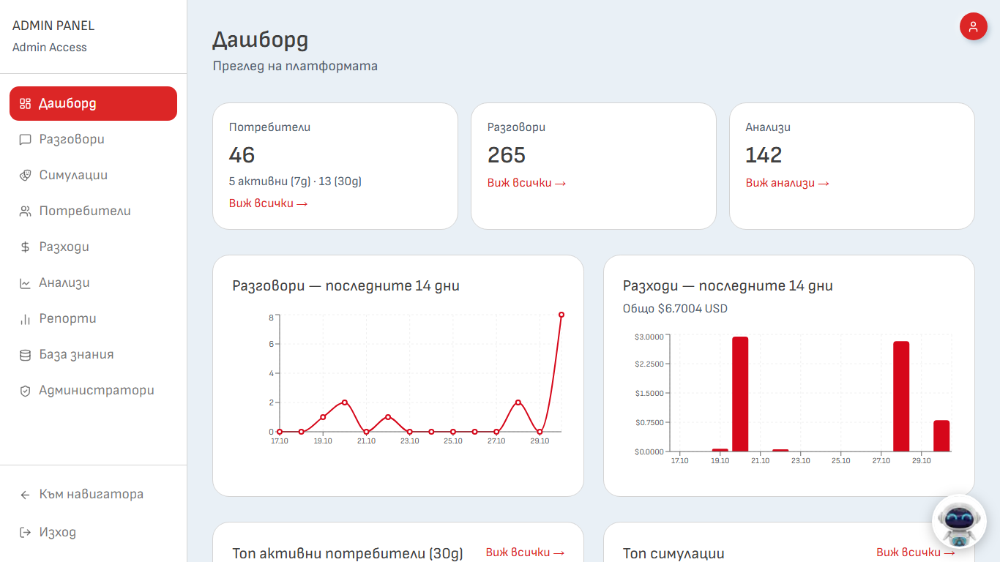
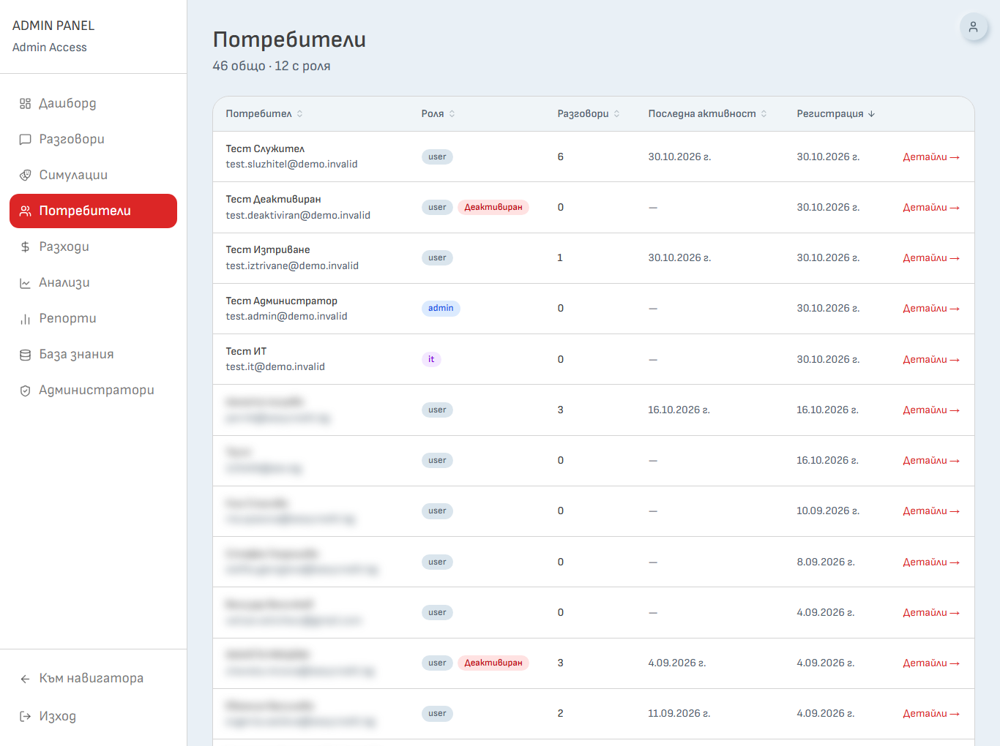
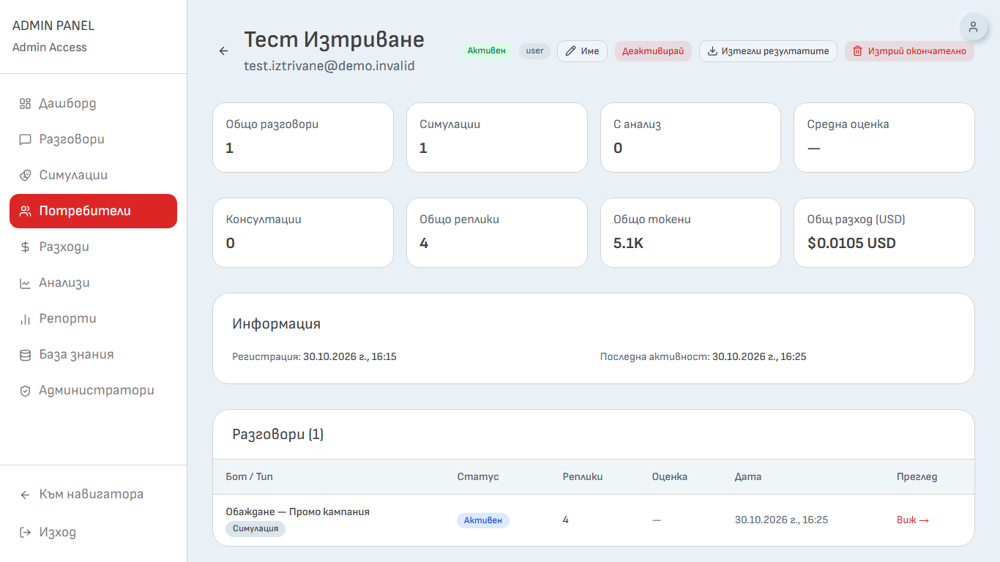
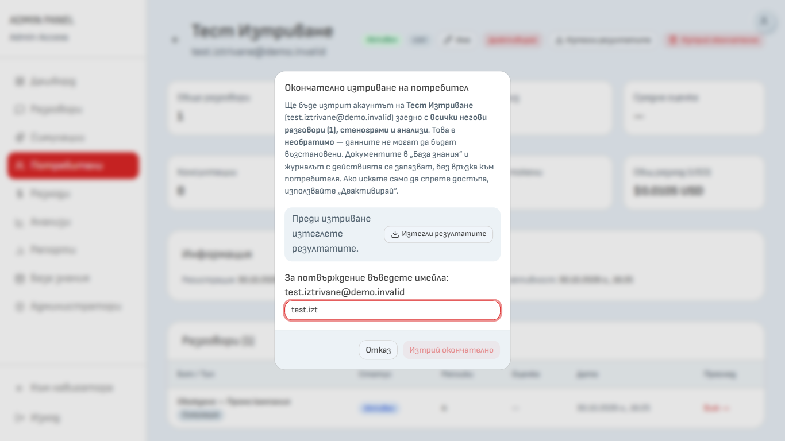
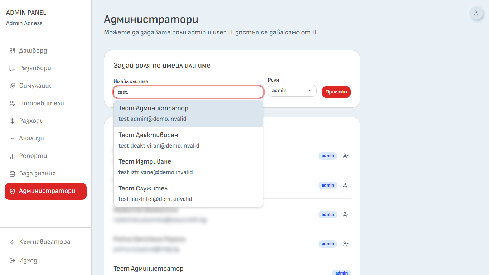
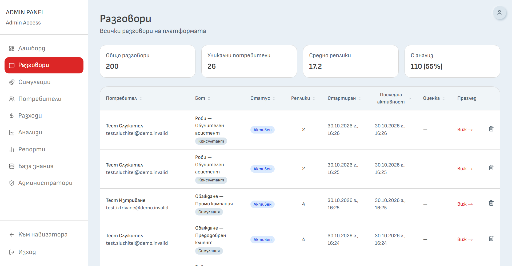
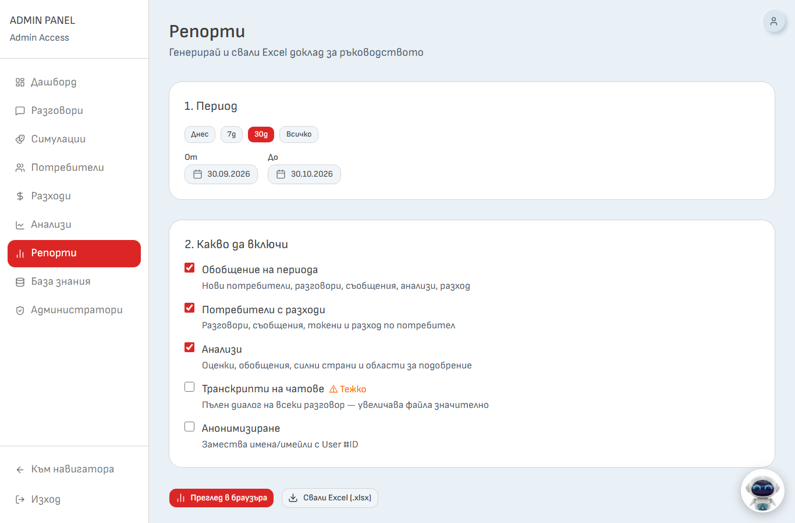
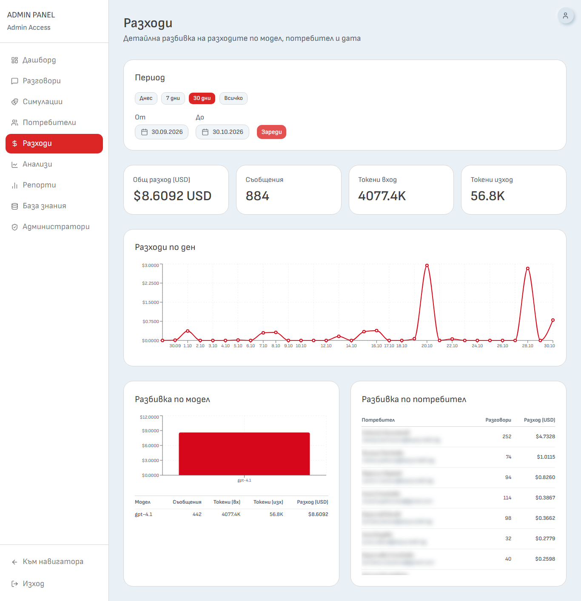
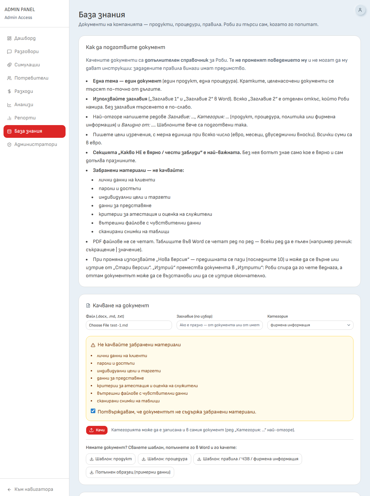
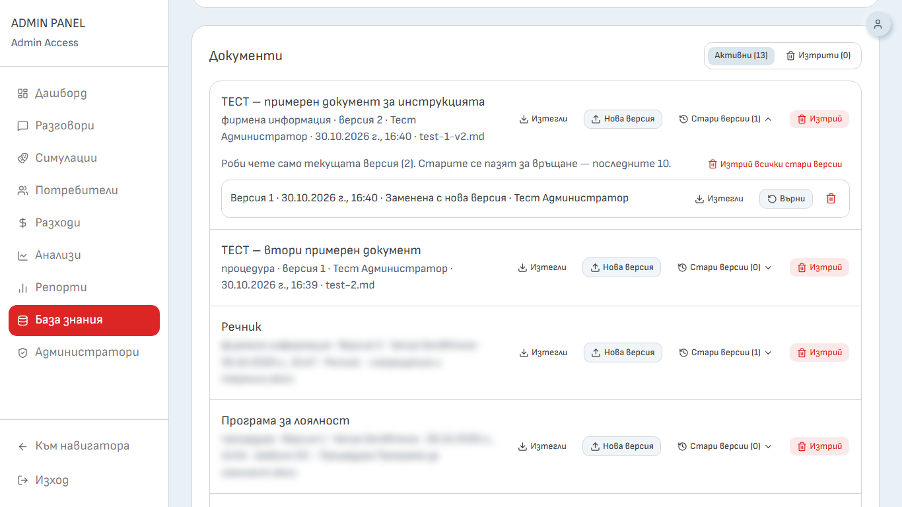

# Навигатор за продажбени умения – инструкция за администратора

> **За кого е този документ:** за администраторите на Easy Credit (роля `admin`). Работите с лични данни на колегите си – отваряйте чужди разговори и анализи само когато е нужно за обучението.

---

## 1. Достъп и дашборд

Админ панелът се отваря от иконата с човече горе вдясно → **Админ панел**. Обратно се връщате с **Към навигатора**.

Менюто вляво съдържа: Дашборд, Разговори, Симулации, Потребители, Разходи, Анализи, Репорти, База знания и Администратори. Техническите настройки (ботове, съдържание на обучението, конфигурация, журнал на действията) се поддържат от екипа на Immersica.

*Снимка 20: Админ панел – „Дашборд“ с менюто вляво*

**Дашбордът** показва броя потребители, разговори и анализи, графики за последните 14 дни, „Топ активни потребители (30д)“ и „Топ симулации“.

---

## 2. Потребители

Отворете **Потребители**. Списъкът показва име и имейл, роля, брой разговори, последна активност и дата на регистрация. Заглавията на колоните подреждат списъка. Деактивираните са с етикет „Деактивиран“. Отворете потребител с **Детайли →**.

*Снимка 21: „Потребители“ – списък*

В системата **няма бутон за създаване на потребител**: акаунтите се създават чрез регистрация, а администраторът след това може да даде роля (вж. раздел 3).

### 2.1. Страница на потребителя

*Снимка 22: Страница на потребител – бутони горе и списък с разговори*

| Бутон | Какво прави |
|---|---|
| **Име** | Поправя показваното име (имейлът не се променя). Записва се със **Запази** |
| **Деактивирай** / **Активирай** | Спира или връща достъпа. Данните се запазват. Не се показва за вашия акаунт |
| **Изтегли резултатите** | Изтегля Excel с резултатите на потребителя |
| **Изтрий окончателно** | Изтрива акаунта и всичките му разговори. Не се показва за вашия акаунт |

Под бутоните има показатели (разговори, симулации, оценка, разход) и таблица „Разговори“. С **Виж →** отваряте стенограмата и анализа.

**Деактивирането** спира само достъпа (например при отсъствие). Потребителят вижда „Този акаунт е деактивиран. Свържете се с администратор.“ Данните му остават и може да бъде активиран отново.

**Изтегляне на резултатите** създава `Navigator_rezultati_<име>_<дата>.xlsx` с листове „Обобщение“, „Анализи“, „Стенограми“ и „Информация“ (с бележка „Само за обучение и развитие, не е оценка на работата“). Включени са само симулациите, не и разговорите с Роби. Файлът съдържа стенограми – пазете го на защитено място.

### 2.2. Окончателно изтриване на потребител

Например при напускане или прекратен договор:

1. **Деактивирайте** потребителя.
2. Ако е нужно, натиснете **Изтегли резултатите** и запазете файла.
3. Натиснете **Изтрий окончателно**, въведете имейла на потребителя и потвърдете.

*Снимка 23: Прозорец „Окончателно изтриване на потребител“*

Изтриват се акаунтът и всички негови разговори (симулации и разговори с Роби), стенограми и анализи. **Не може да се възстанови.** Документите в „База знания“ се запазват, а разходите му остават само в обобщен вид, без връзка към него. Не можете да изтриете себе си.

---

## 3. Роли и администратори

Отворете **Администратори**.

*Снимка 24: „Администратори“ – задаване на роля*

**Даване на роля:** в полето „Имейл или име“ започнете да пишете и изберете човека (при еднакви имена ползвайте имейл); изберете от „Роля“ `user` или `admin`; натиснете **Приложи**. Показва се „Ролята е обновена успешно.“

**Сваляне на достъп:** в списъка „Потребители с роля“ натиснете иконата „Премахни достъп“ до името и потвърдете. Човекът остава в системата като `user`.

Не можете да променяте собствената си роля. Ролята `it` е на техническия екип на Immersica и не се променя от администратор.

**Организационно:** кой става администратор решава Easy Credit. Предлагаме администратори да са само хора от звеното „Обучение и развитие“, защото администраторите виждат стенограмите и анализите на всички.

---

## 4. Разговори, симулации и анализи

### 4.1. Разговори

Отворете **Разговори** – показват се последните **200** разговора (симулации и разговори с Роби). Горе има показатели (Общо разговори, Уникални потребители, Средно реплики, С анализ).

*Снимка 25: „Разговори“ – списък със статистика*

- **Виж →** отваря разговора с „Транскрипт“ и „Анализ“. Под отговорите на Роби се вижда „Търсене (документи / обучение)“ – какво е търсил Роби и кои заглавия е намерил.
- Ако симулацията няма анализ, има бутон **Генерирай анализ** (нужни са 6 реплики).
- Иконата кошче („Изтрий разговор“) и бутонът **Изтрий разговора** изтриват разговора със съобщенията и анализа му, след потвърждение. Не може да се възстанови, а разходът на този разговор изчезва от справките „Разходи“ и „Репорти“.

**Системата не записва кой администратор е отварял чужд разговор.** Отваряйте само когато е нужно.

### 4.2. Симулации, Анализи

- **Симулации** – за всеки сценарий: Проведени, Потребители, Ср. оценка. „Детайли →“ показва преминалите потребители и разговорите.
- **Анализи** – задайте период (7 дни, 30 дни, Всичко или От / До), по избор отметнете потребители и натиснете **Зареди анализи**. Бутонът **Обобщи** („AI Обобщение“) прави кратко обобщение с препоръки за екипа. Към OpenAI се изпращат само силни страни, подобрения и обобщения, **без имена и имейли**. Натискайте го само при нужда – вика AI и струва пари.

---

## 5. Репорти (Excel доклад)

Отворете **Репорти**.

*Снимка 26: „Репорти“ – период, избор на съдържание, бутони*

1. Изберете **период** – „Днес“, „7д“, „30д“, „Всичко“ или От / До.
2. Отбележете какво да се включи:

   | Отметка | Какво добавя |
   |---|---|
   | Обобщение на периода | Нови потребители, разговори, съобщения, анализи, разход |
   | Потребители с разходи | Разговори, съобщения, токени и разход по потребител |
   | Анализи | Оценки, обобщения, силни страни, области за подобрение |
   | Транскрипти на чатове | Пълният диалог на всеки разговор (отбелязано „Тежко“) |
   | Анонимизиране | Замества имена и имейли с „User #N“ |

3. **Преглед в браузъра** показва доклада на екрана, а **Свали Excel (.xlsx)** изтегля файл `report_<от>_do_<до>.xlsx`.

Внимание:

- „Транскрипти на чатове“ изнася разговорите на **всички** потребители за периода, включително с Роби. Включвайте го само при реална нужда.
- „Анонимизиране“ маха имената и имейлите от колоните, но **не** и имена, написани в самите разговори и анализи.
- Файлът е с лични данни. Пазете го на защитено място и го изтрийте, когато не е нужен.

---

## 6. Разходи

Отворете **Разходи**, изберете период („Днес“, „7 дни“, „30 дни“, „Всичко“ или От / До) и натиснете **Зареди**. Показват се общ разход, съобщения, токени, „Разходи по ден“, „Разбивка по модел“ и „Разбивка по потребител“.

*Снимка 27: „Разходи“ – период и разбивка*

Сумите са в **USD**. В разходите влизат отговорите на AI клиентите и на Роби, но **не** влизат анализите, микрофонът (превръщането на реч в текст) и търсенето в документите – реалният разход при OpenAI е по-висок.

---

## 7. База знания

В **База знания** качвате документи (продукти, процедури, политики, фирмена информация), които Роби използва като справочник. Документите **не променят поведението** на Роби и не могат да му дават инструкции.

*Снимка 28: „База знания“ – указания и „Качване на документ“*

### 7.1. Как да подготвите документ

- Една тема – един документ (един продукт, една процедура).
- Ползвайте заглавия („Заглавие 1“ и „Заглавие 2“ в Word) – всяко „Заглавие 2“ е отделен откъс, който Роби намира.
- Най-отгоре напишете редове `Заглавие: …`, `Категория: …` (продукт, процедура, политика или фирмена информация) и `Валидно от: …`.
- Пишете цели изречения, с мерна единица при всяко число. Сумите са в евро.
- Секцията „Какво НЕ е вярно / чести заблуди“ е най-важната за Роби.
- Формати: `.docx`, `.md`, `.txt`, най-много 4 MB. PDF не се приема. Шаблони можете да свалите от картата „Качване на документ“.

### 7.2. Забранени материали

Не качвайте:

- лични данни на клиенти;
- пароли и достъпи;
- индивидуални цели и таргети;
- данни за представяне;
- критерии за атестация и оценка на служители;
- вътрешни файлове с чувствителни данни;
- сканирани снимки на таблици.

При всяко качване (нов документ или нова версия) екранът показва този списък с отметка **„Потвърждавам, че документът не съдържа забранени материали.“**. Без нея бутонът е неактивен, а сървърът отказва качването.

### 7.3. Качване, версии, изтриване

1. В „Качване на документ“ изберете **Файл**, по избор **Заглавие** и **Категория** (ако не е записана в документа).
2. Поставете отметката за потвърждение и натиснете **Качи**. При успех се показва „Документът е качен и индексиран (… откъса).“

*Снимка 29: „Документи“ – действия и разгънати „Стари версии“*

| Бутон | Какво прави |
|---|---|
| **Изтегли** | Изтегля текста, който Роби чете, като `.md`. Оригиналният файл не се пази |
| **Нова версия** | След потвърждение за забранените материали качва новия файл. Предишната версия се пази (последните 10) |
| **Стари версии (n)** | История с **Изтегли**, **Върни** и изтриване на стара версия |
| **Изтрий** | Премества документа в „Изтрити“. Роби спира да го чете веднага, но текстът остава в системата |

В раздела **Изтрити**: **Възстанови** връща документа, а **Изтрий окончателно** изтрива завинаги документа, старите му версии и откъсите му. Роби чете само текущата версия.

> Ако по грешка е качен документ със забранени материали: **Изтрий** → отворете „Изтрити“ → **Изтрий окончателно**. Така се махат и старите версии.

Документите нямат автоматичен срок на съхранение – остават, докато не ги изтриете.

---

## 8. Срок на съхранение

- Всяка нощ системата изтрива окончателно **разговорите, по-стари от 12 месеца**, със стенограмите и анализите им – за потребителя и за администратора. Срокът тече за всеки разговор поотделно.
- Изтритите данни не могат да се възстановят, затова при нужда първо изтеглете резултатите на потребителя.
- Акаунтите и документите в „База знания“ не се изтриват автоматично.
- Срокът се определя от системата и не се настройва от админ панела.
- Когато потребител поиска да бъде изтрит, ползвайте **Изтрий окончателно** (раздел 2.2).

---

## 9. Добри практики

- Отваряйте стенограми и анализи само с обучителна причина.
- Не ползвайте оценките за оценка на работата или за решения за служителя. Системата е за обучение и развитие.
- Изнасяйте стенограми („Репорти“) само при нужда и ползвайте „Анонимизиране“, когато е възможно.
- Не копирайте стенограми в неохранявани места (писма, чатове).
- Преглеждайте редовно списъка в „Администратори“.

---

## 10. Към кого да се обърнете

За техническа помощ – към Immersica: **Нина Станкова, ninachupetlovska@gmail.com**.
